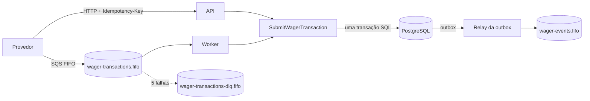
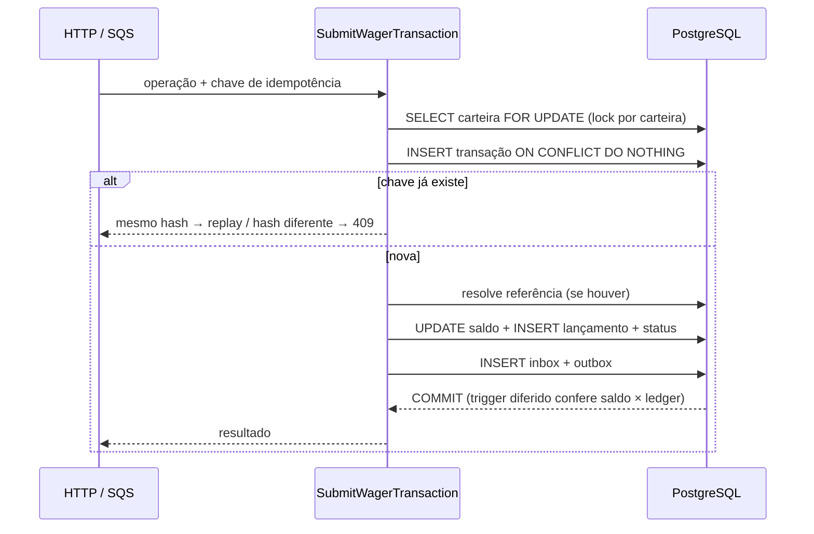

# chimp-ledger

Carteira e ledger para apostas distribuídas. O serviço recebe operações de vários provedores de jogos (`BET`, `WIN`, `LOSS`, `REFUND`, `ROLLBACK`) por HTTP e por SQS, e continua correto quando essas mensagens chegam **duplicadas**, **fora de ordem** ou **ao mesmo tempo em várias instâncias**.

Construído para o desafio técnico de Backend da Jungle Gaming.

---

## O problema, em uma frase

Dinheiro não pode aparecer nem sumir. Todo o resto do projeto existe para defender essa frase contra quatro situações que vão acontecer em produção:

| Situação | Exemplo | O que eu não posso deixar acontecer |
|---|---|---|
| **Duplicação** | o provedor reenvia a mesma BET porque não recebeu resposta | debitar duas vezes |
| **Desordem** | o REFUND chega antes da BET que ele desfaz | rejeitar uma operação válida só porque a fila trocou a ordem |
| **Concorrência** | duas apostas de 80 disputam um saldo de 100 em instâncias diferentes | saldo negativo, ou as duas passarem |
| **Falha no meio** | o processo morre depois do commit e antes de confirmar a mensagem | perder o evento, ou aplicar de novo na reentrega |

---

## Como cada garantia é sustentada

A regra que guiou o projeto: **uma garantia financeira não pode depender de uma camada só**. Toda invariante importante é protegida pelo domínio *e* pelo banco, e tem um teste que tenta quebrá-la.

| Garantia | No domínio | No banco | Teste que prova |
|---|---|---|---|
| Dinheiro exato | `Money` com `decimal.js`, entrada só com 2 casas | `NUMERIC(19,2)` | `test/unit/shared/money.test.ts` |
| Saldo nunca negativo | `Wallet.debit` recusa | `CHECK (balance >= 0)` | `schema-constraints.test.ts` |
| Saldo só muda com lançamento | `debit`/`credit` sempre devolvem o lançamento | trigger **diferido** confere no commit | `schema-constraints.test.ts` |
| Ledger imutável | entidade congelada, sem métodos de escrita | trigger bloqueia `UPDATE`/`DELETE`/`TRUNCATE` + app sem permissão | `schema-constraints.test.ts` |
| Ledger encadeado | cada lançamento leva o hash do anterior | trigger exige que o primeiro seja o 1 e que sequência, saldo e `prev_hash` continuem do anterior | `wallet-ledger-entry.test.ts`, `ledger-chain.test.ts` |
| Uma carteira por jogador + moeda | — | `UNIQUE (player_id, currency)` | `wallets.http.test.ts` |
| Reverter só uma vez | regra de ciclo de vida no `WagerProcessor` | índice único parcial | `schema-constraints.test.ts` |
| Aposta liquidada é fechada | WIN/LOSS válido impede nova liquidação e reembolso | — | `submit-wager.test.ts` (liquidação) |
| Estado final é final | transições lançam erro | trigger bloqueia mudança de status terminal | `wager-transaction.test.ts` |
| Idempotência persistente | `payloadHash` canônico | `UNIQUE (provider_id, idempotency_key)` | `submit-wager.test.ts`, `same-wallet.test.ts` |
| Provedor só age por si | o provedor vem do token, não do corpo | — | `auth.test.ts` (Keycloak real) |
| Saldo alheio não vaza | recusa sem snapshot de saldo | `CHECK` proíbe snapshot nessa recusa | `submit-wager.test.ts` |
| Eventos em ordem por carteira | relay reivindica carteiras inteiras, em lotes ordenados | `SKIP LOCKED` + lease | `outbox-relay.test.ts` |

Toda linha desta tabela tem uma sabotagem correspondente em `bun run test:mutation`: o código é quebrado de propósito e o teste precisa falhar.

> **Por que no banco também?** Porque bug acontece, e SQL manual também. Se um dia alguém atualizar um saldo direto no Postgres sem o lançamento correspondente, o commit falha. A aplicação não precisa ser perfeita para o dinheiro ficar certo.

---

## Arquitetura

Monólito modular, com módulos separados em `domain` / `application` / `infrastructure`. O domínio não conhece NestJS, MikroORM nem Bun, e existe um teste (`test/architecture`) que falha se alguém quebrar essa fronteira.



**Uma porta só para o dinheiro.** HTTP e fila chamam o mesmo caso de uso. Não existe outro código que escreva em `wallets` ou no ledger.

**O fluxo de uma aposta** (dentro de uma única transação SQL):



### Decisões principais

- **Lock pessimista por carteira** (`SELECT … FOR UPDATE`). A disputa só existe dentro da mesma carteira, então carteiras diferentes andam em paralelo e a carteira quente vira uma fila ordenada. Escolhi isso em vez de lock otimista porque, numa carteira muito disputada, o otimista vira uma tempestade de retries.
- **`lock_timeout` de 2s.** Carteira travada demais não prende conexão: vira erro transitório (`503` no HTTP, nova tentativa na fila).
- **Ledger encadeado por hash.** Cada lançamento guarda o hash do anterior. Trigger e permissão impedem alteração pela aplicação, e a corrente acusa até alteração feita por um DBA.
- **Replay devolve o saldo daquele momento**, não o atual. A transação guarda um snapshot do saldo ao ficar final.
- **Domínio puro + `EntitySchema`.** As entidades de domínio têm construtor privado e fábricas (`create`, `rehydrate`); a persistência fica em schemas e mappers separados.
- **Escrita explícita no repositório** (`insert`/`nativeUpdate` em ordem) em vez do flush automático do Unit of Work, porque há FK entre carteira, transação e lançamento, e um trigger que confere tudo no commit.
- **Outbox por carteira.** O relay reivindica carteiras inteiras com `SKIP LOCKED` e lease, e publica os eventos de cada uma em lotes ordenados de até 10. Processo morto no meio: o lease vence e outro assume.
- **Inbox + idempotência no banco**, não no SQS. A deduplicação do FIFO é otimização; quem garante que nada é aplicado duas vezes é o Postgres.
- **Autenticação atrás de uma porta.** A aplicação só conhece `IdentityProvider`; o adaptador valida o JWT do Keycloak pela JWKS. Guard global fechado por padrão, escopos por rota e o provedor sempre tirado do token.

---

## Stack

| | Escolha | Por quê |
|---|---|---|
| Runtime | **Bun 1.x** | runtime, gerenciador de pacotes e test runner num binário só |
| Framework | **NestJS 11 + Fastify** | DI explícito, Fastify com limite de body nativo |
| ORM | **MikroORM 6** | `EntityManager.transactional`, `LockMode`, migrações reversíveis |
| Banco | **PostgreSQL 16** | `NUMERIC` exato, triggers, constraints diferidas |
| Fila | **SQS FIFO (LocalStack)** | DLQ por redrive, agrupamento por carteira |
| Dinheiro | **decimal.js** | nada de `number` encostando em valor |
| Validação | **zod** (`.strict()`) | campo desconhecido é recusado, não ignorado |
| Autenticação | **Keycloak + jose** | OIDC padrão, JWT validado pela JWKS, sem SDK pesado |
| Observabilidade | **pino + prom-client, Prometheus e Grafana** | logs JSON com ids de rastreio, métricas e dashboard versionado |
| Testes | **bun test + Testcontainers** | Postgres, LocalStack e Keycloak reais, nada de mock de infra |
| Qualidade | **TypeScript strict + Biome + GitHub Actions** | `noUncheckedIndexedAccess`, lint e format rápidos, CI em todo PR |

---

## Rodando localmente

**Pré-requisitos:** [Bun 1.x](https://bun.sh) e Docker (Desktop ou Engine) com Compose.

### Tudo com um comando

```bash
docker compose --profile app up -d --build --wait
```

Sobe Postgres, LocalStack, **3 réplicas da API atrás de um nginx**, o worker, o Prometheus e o Grafana. Um serviço de setup aplica as migrações, cria as filas e cadastra os provedores de desenvolvimento antes de tudo.

| Endereço | O que é |
|---|---|
| `http://localhost:8080` | API (balanceada entre as 3 réplicas) |
| `http://localhost:3030` | Grafana, já aberto no dashboard do chimp-ledger |
| `http://localhost:9090` | Prometheus |

Com a stack no ar, `bun run test:load` gera carga e o dashboard mostra vazão, latência, lag da outbox e o resto ao vivo.

### Desenvolvimento, processo por processo

```bash
bun install
docker compose up -d --wait        # Postgres 16 + LocalStack (SQS)
cp .env.example .env
bun run migration:up               # cria esquema, triggers e permissões
bun run setup:sqs                  # cria as filas FIFO e a DLQ no LocalStack
bun run seed:dev                   # provedores provider-a e provider-b
bun run start:api                  # http://localhost:3000
bun run start:worker               # outra aba: fila, outbox e referências pendentes
```

Para ligar a autenticação: `docker compose --profile auth up -d --wait` sobe o Keycloak com o realm versionado, e `AUTH_ENABLED=true` no `.env` passa a exigir token.

O Postgres sobe com dois usuários: `chimp_migrator`, dono das tabelas e usado só nas migrações, e `chimp_app`, usado pela aplicação, **sem permissão** de `UPDATE`/`DELETE` no ledger.

Para derrubar tudo e apagar os dados: `docker compose down -v`.

**Fora do Docker:** a migração cria o papel `chimp_app` sem login e só concede as permissões. No compose, quem dá login e senha é o `docker/postgres/01-roles.sql`, executado no primeiro boot do Postgres. Em outro servidor, crie o papel antes de migrar (`create role chimp_app login password '...'`) e aponte `DATABASE_URL` para ele.

---

## API

Os exemplos usam `localhost:3000` (API rodando local). Com a stack completa do Compose, use `localhost:8080`.

### Carteiras

```bash
# abrir carteira (gera OPENING + lançamento de crédito na mesma transação)
curl -X POST http://localhost:3000/wallets \
  -H 'content-type: application/json' \
  -d '{"playerId":"0192f28f-5dc0-7d58-bdb2-814ad6a0f4a1","initialBalance":{"amount":"1000.00","currency":"BRL"}}'

# {"id":"…","playerId":"0192f28f-…","balance":{"amount":"1000.00","currency":"BRL"},"version":1}

curl http://localhost:3000/wallets/<walletId>
curl "http://localhost:3000/wallets/<walletId>/ledger?limit=50"          # cursor opaco em nextCursor
curl -X POST http://localhost:3000/wallets/<walletId>/reconciliation    # saldo × ledger × corrente
```

### Apostas

```bash
curl -X POST http://localhost:3000/wagering/transactions \
  -H 'content-type: application/json' \
  -H 'Idempotency-Key: provider-a:transaction-123' \
  -d '{"providerId":"provider-a","externalTransactionId":"transaction-123","playerId":"0192f28f-5dc0-7d58-bdb2-814ad6a0f4a1","walletId":"<walletId>","roundId":"round-987","gameId":"fortune-chimp","kind":"BET","money":{"amount":"25.00","currency":"BRL"}}'

# {"transactionId":"…","status":"PROCESSED","balance":{"amount":"975.00","currency":"BRL"},"idempotentReplay":false}
```

Pela fila, a mesma operação vai em `wager-transactions.fifo` no envelope `WagerTransactionRequested` do enunciado.

### Autenticação

Com `AUTH_ENABLED=true`, toda rota exige `Authorization: Bearer <token>`, menos `/health/*` e `/metrics`. Cada provedor é um client do Keycloak (`client_credentials`), e o `provider_id` vem do token.

| Escopo | Libera | Quem tem |
|---|---|---|
| `wager:write` | enviar apostas (só em nome do próprio provedor) | provedores |
| `wallet:read` | consultar carteira e transações (do próprio provedor) | provedores, backoffice |
| `wallet:write` | abrir carteira | backoffice |
| `wallet:reconcile` | rodar a reconciliação | backoffice |
| `ledger:read` | ler o ledger completo da carteira | backoffice |
| `wager:read:any` | ler transações de qualquer provedor | backoffice |

```bash
curl -s -X POST http://localhost:8081/realms/chimp/protocol/openid-connect/token \
  -d grant_type=client_credentials -d client_id=provider-a -d client_secret=provider-a-dev-secret
```

### Mapa de status

O mesmo em todos os endpoints, para o provedor decidir **sem ler a mensagem de erro**:

| Status | Significado | O provedor deve |
|---|---|---|
| `200` / `201` | processado (`200` em replay) | seguir |
| `202` | aceito, aguardando a transação referenciada | consultar depois |
| `400` | payload inválido | corrigir antes de reenviar |
| `404` | recurso não existe | corrigir |
| `409` | conflito de idempotência ou duplicidade | não reenviar igual |
| `422` | recusado por regra de negócio (ver `failureCode`) | não insistir |
| `503` | falha temporária nossa (`Retry-After`) | reenviar depois |

Erros sempre no formato `{ "code": "...", "message": "...", "retryable": false }`.

### Códigos de falha

Cada `failureCode` vem com uma ação recomendada (`src/wagering/domain/failure-code.ts`):

| Código | Ação |
|---|---|
| `INSUFFICIENT_FUNDS` | desistir |
| `NEGATIVE_BALANCE_PREVENTED` | desistir (reversão que deixaria saldo negativo; pede análise) |
| `ALREADY_REVERSED` | desistir (a referência já foi revertida) |
| `BET_ALREADY_SETTLED` | desistir (a aposta já foi liquidada com WIN ou LOSS) |
| `REFERENCE_NOT_PROCESSED` | desistir |
| `REFERENCE_NOT_FOUND` · `REFERENCE_MISMATCH` · `INVALID_REFERENCE_KIND` · `AMOUNT_MISMATCH` · `CURRENCY_MISMATCH` · `WALLET_PLAYER_MISMATCH` | corrigir o payload |

---

## Testes

```bash
bun run test:unit          # domínio puro + regra de arquitetura (rápido, sem Docker)
bun run test:integration   # Postgres, LocalStack e Keycloak reais via Testcontainers
bun run test:concurrency   # várias instâncias reais, simulação com seed, processos derrubados
bun test                   # tudo
bun run test:mutation      # sabota cada garantia e confere que algum teste percebe
bun run test:load          # carga, com relatório e verificação das invariantes
bun run typecheck && bun run lint
```

**Teste que testa mesmo.** `bun run test:mutation` quebra de propósito, uma de cada vez, 11 garantias (lock por carteira, idempotência, reversão única, ledger imutável, `SKIP LOCKED` da outbox, provedor vindo do token...), roda os testes que deveriam perceber e confere que eles falham. Resultado atual: **11 de 11 detectadas**.

**Onde cada exigência do desafio está provada:** [`docs/RASTREABILIDADE.md`](docs/RASTREABILIDADE.md) liga cada item do enunciado, inclusive as falhas eliminatórias, ao código e ao teste que prova. O relatório de carga está em [`docs/LOAD_TEST.md`](docs/LOAD_TEST.md).

Os testes de integração sobem containers próprios por arquivo, então nenhum teste enxerga dado de outro. Precisa do Docker rodando.

Destaques do que é testado contra o banco real:
- alterar saldo sem lançamento → o **commit** falha;
- `UPDATE` no ledger → recusado pelo trigger e, para o usuário da aplicação, por falta de permissão;
- lançamento que não encadeia no anterior → recusado;
- REFUND e depois ROLLBACK da mesma BET → o segundo é recusado pelo índice único;
- a migração desce e sobe de novo sem sobrar nada.

---

## Estrutura

```
src/
  shared/      Money, erros de domínio, JSON canônico, config, banco, HTTP, logs e métricas
  wallet/      Wallet, ledger encadeado, abertura, consulta, ledger paginado e reconciliação
  wagering/    WagerTransaction, processamento, reprocessamento de pendências, códigos de falha, eventos
  messaging/   inbox, outbox, relay, consumidor SQS, topologia das filas
  auth/        porta de identidade, adaptador JWT/OIDC, guard e escopos
  health/      vivacidade e prontidão
  bootstrap/   montagem do Nest (api e worker)
migrations/    SQL escrito à mão, com up e down
scripts/       migração, filas e dados de desenvolvimento
docker/        papéis do Postgres, realm do Keycloak, nginx, Prometheus e Grafana
docs/          rastreabilidade do enunciado e relatório de carga
test/
  unit/ · integration/ · concurrency/ · architecture/ · load/ · mutation/ · support/
```

---

## Status

O projeto foi entregue em fatias verticais, cada uma testada antes da próxima, com revisão de código e de segurança entre os blocos.

- [x] Domínio: `Money`, `Wallet`, ledger encadeado, `WagerTransaction`, regras de referência, inbox/outbox, eventos
- [x] Esquema com garantias no banco (constraints, triggers, permissões) e migrações reversíveis
- [x] Abertura e consulta de carteira via HTTP, mapa único de erros
- [x] Submissão de transações (`POST /wagering/transactions`) com idempotência
- [x] Testes de concorrência com várias instâncias reais (simulação com seed)
- [x] Relay da outbox, consumidor SQS com DLQ e desligamento sem perder mensagem
- [x] Reprocessamento de referências pendentes com backoff
- [x] Ledger paginado e reconciliação (sinaliza divergência, nunca corrige)
- [x] Logs estruturados, métricas, health checks e dashboard no Grafana
- [x] Autenticação com Keycloak (OIDC, escopos, provedor vindo do token)
- [x] Teste de carga com relatório, e o gargalo encontrado corrigido
- [x] Recuperação com processos derrubados no meio do trabalho
- [x] Sabotagens dirigidas (`bun run test:mutation`) e mapa de rastreabilidade
- [ ] `ARCHITECTURE.md` com as decisões e trade-offs

---

## Notas de construção

Algumas coisas que só apareceram na hora de rodar contra infraestrutura de verdade:

- **Nome de constraint repetido.** O Postgres dá nome automático para `CHECK` de coluna (`<tabela>_<coluna>_check`), e eu tinha batizado uma constraint de tabela com exatamente esse nome. A migração quebrou na hora, e isso foi bom: um nome ambíguo ia confundir a leitura de erro depois.
- **Uma função de trigger para duas tabelas.** A checagem "saldo bate com o ledger" dispara pela carteira e pelo lançamento, e `NEW` tem campos diferentes em cada tabela. Resolvi olhando `TG_TABLE_NAME`.
- **CRLF quebra script de container.** No Windows o Git converte quebra de linha por padrão; `.gitattributes` fixa LF para o repositório inteiro.
- **`emitDecoratorMetadata` no Bun.** Para não depender de como o runtime emite metadata, todo construtor do Nest usa `@Inject` explícito.
- **Abortar o long polling esconde mensagens.** Cancelar o `ReceiveMessage` no cliente não cancela o receive no servidor: a requisição abandonada ainda pega as mensagens que chegam, e elas ficam invisíveis por um visibility timeout inteiro. O desligamento passou a esperar o receive voltar e devolver o que veio nele.
- **O gargalo da outbox não era paralelismo.** Mais vias de publicação quase não mudaram o lag. Medindo, o SQS do LocalStack aceitava ~480 mensagens/s com uma por chamada e mais de 3.000/s em lotes de 10. A correção foi o lote, com o caso raro de falha no meio dele tratado e medido (detalhes em `docs/LOAD_TEST.md`).
- **Sem o lock, o dinheiro não corrompe: ele falha.** Tirando o `FOR UPDATE` de propósito, os testes de concorrência quebram, mas o saldo continua certo: a versão no `WHERE` e o `UNIQUE (wallet_id, sequence)` barram a escrita concorrente. O lock dá vazão; as outras camadas garantem que o pior caso é erro, nunca saldo errado.

---

## Autor

**Matheus Barbosa** · [github.com/ObarbosaDev](https://github.com/ObarbosaDev)
